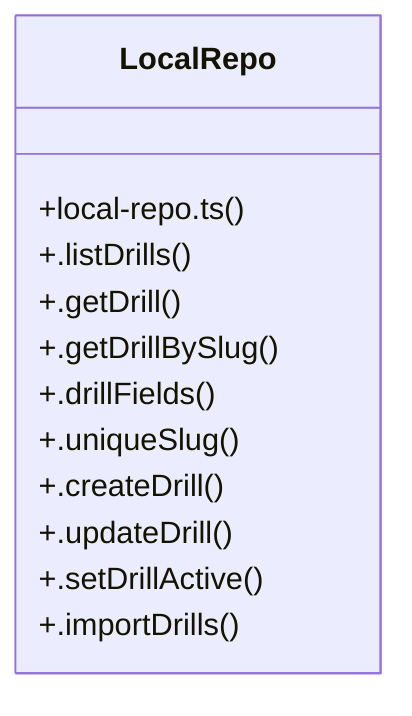

# Community 1

> 24 nodes · cohesion 0.11

## Key Concepts

- [LocalRepo](file:///C:/Users/matth/Code/skill-dev-app/src/lib/data/local-repo.ts#L38) (27 connections)
- [.createDrill()](file:///C:/Users/matth/Code/skill-dev-app/src/lib/data/local-repo.ts#L87) (5 connections)
- [local-repo.ts](file:///C:/Users/matth/Code/skill-dev-app/src/lib/data/local-repo.ts#L1) (4 connections)
- [.importDrills()](file:///C:/Users/matth/Code/skill-dev-app/src/lib/data/local-repo.ts#L112) (4 connections)
- [.uniqueSlug()](file:///C:/Users/matth/Code/skill-dev-app/src/lib/data/local-repo.ts#L77) (4 connections)
- [.drillFields()](file:///C:/Users/matth/Code/skill-dev-app/src/lib/data/local-repo.ts#L59) (3 connections)
- [.getDrillBySlug()](file:///C:/Users/matth/Code/skill-dev-app/src/lib/data/local-repo.ts#L54) (3 connections)
- [.updateDrill()](file:///C:/Users/matth/Code/skill-dev-app/src/lib/data/local-repo.ts#L100) (3 connections)
- [first](file:///C:/Users/matth/Code/skill-dev-app/src/lib/domain/recommend.test.ts#L190) (3 connections)
- [slugify()](file:///C:/Users/matth/Code/skill-dev-app/src/lib/data/local-repo.ts#L20) (2 connections)
- [.activeEnrolment()](file:///C:/Users/matth/Code/skill-dev-app/src/lib/data/local-repo.ts#L302) (1 connections)
- [.activeSession()](file:///C:/Users/matth/Code/skill-dev-app/src/lib/data/local-repo.ts#L161) (1 connections)
- [.getDrill()](file:///C:/Users/matth/Code/skill-dev-app/src/lib/data/local-repo.ts#L50) (1 connections)
- [.getProfile()](file:///C:/Users/matth/Code/skill-dev-app/src/lib/data/local-repo.ts#L228) (1 connections)
- [.getProgramPlan()](file:///C:/Users/matth/Code/skill-dev-app/src/lib/data/local-repo.ts#L287) (1 connections)
- [.getSession()](file:///C:/Users/matth/Code/skill-dev-app/src/lib/data/local-repo.ts#L150) (1 connections)
- [.listDrills()](file:///C:/Users/matth/Code/skill-dev-app/src/lib/data/local-repo.ts#L39) (1 connections)
- [.listExercises()](file:///C:/Users/matth/Code/skill-dev-app/src/lib/data/local-repo.ts#L263) (1 connections)
- [.listPositions()](file:///C:/Users/matth/Code/skill-dev-app/src/lib/data/local-repo.ts#L259) (1 connections)
- [.listPrograms()](file:///C:/Users/matth/Code/skill-dev-app/src/lib/data/local-repo.ts#L277) (1 connections)
- [.listRepLogs()](file:///C:/Users/matth/Code/skill-dev-app/src/lib/data/local-repo.ts#L201) (1 connections)
- [.listSessions()](file:///C:/Users/matth/Code/skill-dev-app/src/lib/data/local-repo.ts#L154) (1 connections)
- [.setDrillActive()](file:///C:/Users/matth/Code/skill-dev-app/src/lib/data/local-repo.ts#L108) (1 connections)
- [notDeleted()](file:///C:/Users/matth/Code/skill-dev-app/src/lib/data/local-repo.ts#L339) (1 connections)

## Class Diagram

## Relationships

- No strong cross-community connections detected

## Source Files

- [C:\Users\matth\Code\skill-dev-app\src\lib\data\local-repo.ts](file:///C:/Users/matth/Code/skill-dev-app/src/lib/data/local-repo.ts)
- [C:\Users\matth\Code\skill-dev-app\src\lib\domain\recommend.test.ts](file:///C:/Users/matth/Code/skill-dev-app/src/lib/domain/recommend.test.ts)

## Audit Trail

- EXTRACTED: 67 (93%)
- INFERRED: 5 (7%)
- AMBIGUOUS: 0 (0%)

---

_Part of the graphify knowledge wiki. See [[index]] to navigate._
