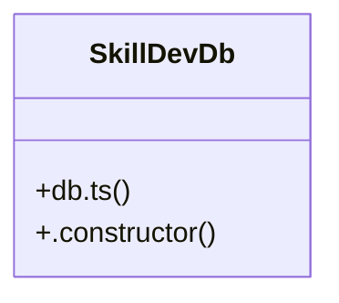

# Community 13

> 4 nodes · cohesion 0.50

## Key Concepts

- [db.ts](file:///C:/Users/matth/Code/skill-dev-app/src/lib/data/db.ts#L1) (2 connections)
- [SkillDevDb](file:///C:/Users/matth/Code/skill-dev-app/src/lib/data/db.ts#L31) (2 connections)
- [db](file:///C:/Users/matth/Code/skill-dev-app/src/lib/data/db.ts#L133) (1 connections)
- [.constructor()](file:///C:/Users/matth/Code/skill-dev-app/src/lib/data/db.ts#L45) (1 connections)

## Class Diagram

## Relationships

- No strong cross-community connections detected

## Source Files

- [C:\Users\matth\Code\skill-dev-app\src\lib\data\db.ts](file:///C:/Users/matth/Code/skill-dev-app/src/lib/data/db.ts)

## Audit Trail

- EXTRACTED: 6 (100%)
- INFERRED: 0 (0%)
- AMBIGUOUS: 0 (0%)

---

_Part of the graphify knowledge wiki. See [[index]] to navigate._
