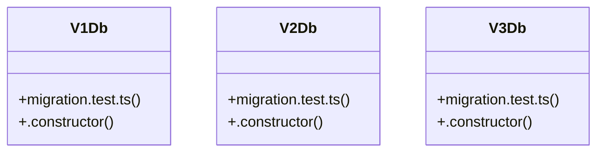

# Community 6

> 16 nodes · cohesion 0.12

## Key Concepts

- [migration.test.ts](file:///C:/Users/matth/Code/skill-dev-app/src/lib/data/migration.test.ts#L1) (12 connections)
- [V1Db](file:///C:/Users/matth/Code/skill-dev-app/src/lib/data/migration.test.ts#L19) (2 connections)
- [V2Db](file:///C:/Users/matth/Code/skill-dev-app/src/lib/data/migration.test.ts#L96) (2 connections)
- [V3Db](file:///C:/Users/matth/Code/skill-dev-app/src/lib/data/migration.test.ts#L165) (2 connections)
- [drill](file:///C:/Users/matth/Code/skill-dev-app/src/lib/data/migration.test.ts#L120) (1 connections)
- [profile](file:///C:/Users/matth/Code/skill-dev-app/src/lib/data/migration.test.ts#L210) (1 connections)
- [repLog](file:///C:/Users/matth/Code/skill-dev-app/src/lib/data/migration.test.ts#L44) (1 connections)
- [session](file:///C:/Users/matth/Code/skill-dev-app/src/lib/data/migration.test.ts#L30) (1 connections)
- [{ SkillDevDb }](file:///C:/Users/matth/Code/skill-dev-app/src/lib/data/migration.test.ts#L71) (1 connections)
- [v1](file:///C:/Users/matth/Code/skill-dev-app/src/lib/data/migration.test.ts#L64) (1 connections)
- [.constructor()](file:///C:/Users/matth/Code/skill-dev-app/src/lib/data/migration.test.ts#L20) (1 connections)
- [v2](file:///C:/Users/matth/Code/skill-dev-app/src/lib/data/migration.test.ts#L72) (1 connections)
- [.constructor()](file:///C:/Users/matth/Code/skill-dev-app/src/lib/data/migration.test.ts#L97) (1 connections)
- [v3](file:///C:/Users/matth/Code/skill-dev-app/src/lib/data/migration.test.ts#L141) (1 connections)
- [.constructor()](file:///C:/Users/matth/Code/skill-dev-app/src/lib/data/migration.test.ts#L166) (1 connections)
- [v4](file:///C:/Users/matth/Code/skill-dev-app/src/lib/data/migration.test.ts#L208) (1 connections)

## Class Diagram

## Relationships

- No strong cross-community connections detected

## Source Files

- [C:\Users\matth\Code\skill-dev-app\src\lib\data\migration.test.ts](file:///C:/Users/matth/Code/skill-dev-app/src/lib/data/migration.test.ts)

## Audit Trail

- EXTRACTED: 30 (100%)
- INFERRED: 0 (0%)
- AMBIGUOUS: 0 (0%)

---

*Part of the graphify knowledge wiki. See [[index]] to navigate.*