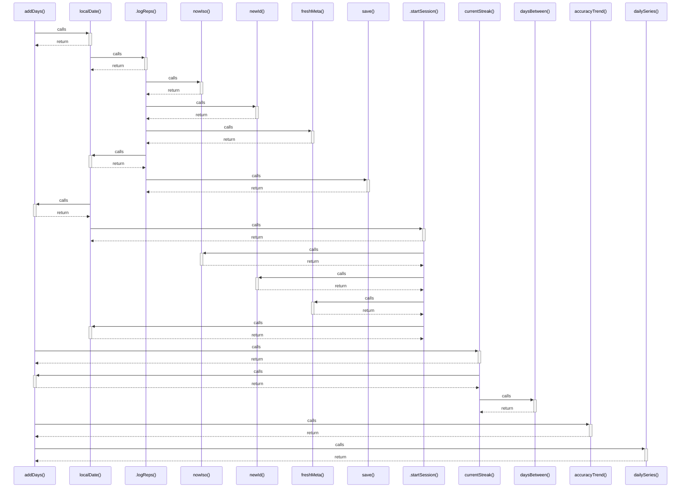

# addDays()

> God node · 5 connections · [C:\Users\matth\Code\skill-dev-app\src\lib\util\time.ts](file:///C:/Users/matth/Code/skill-dev-app/src/lib/util/time.ts#L18)

## Call Trace Diagram

## Connections by Relation

### calls

- [[localDate()]] `EXTRACTED`
- [[currentStreak()]] `INFERRED`
- [[accuracyTrend()]] `INFERRED`
- [[dailySeries()]] `INFERRED`

### contains

- [[time.ts]] `EXTRACTED`

---

_Part of the graphify knowledge wiki. See [[index]] to navigate._
