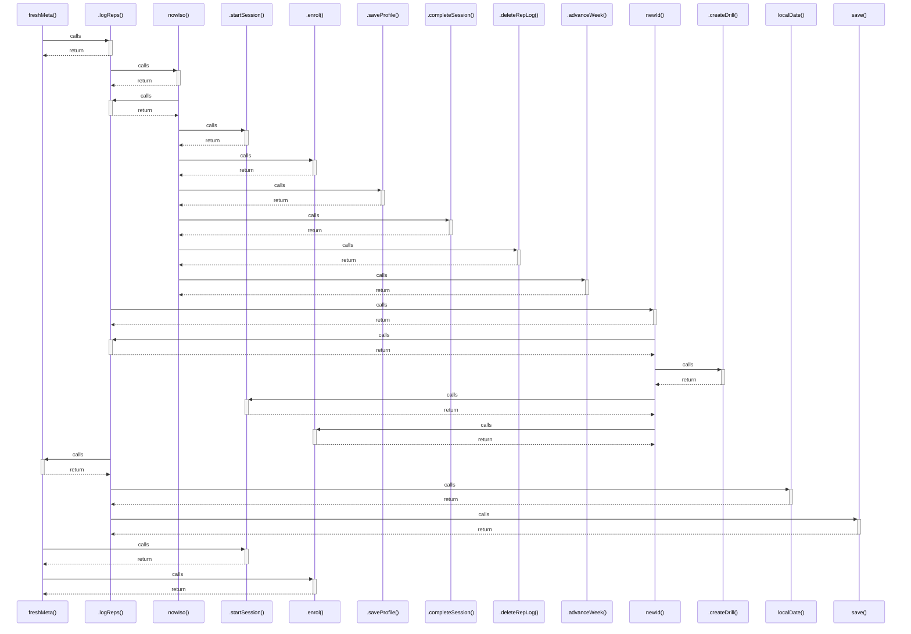

# freshMeta()

> God node · 4 connections · [C:\Users\matth\Code\skill-dev-app\src\lib\data\local-repo.ts](file:///C:/Users/matth/Code/skill-dev-app/src/lib/data/local-repo.ts#L30)

## Call Trace Diagram

## Connections by Relation

### calls
- [[.logReps()]] `EXTRACTED`
- [[.startSession()]] `EXTRACTED`
- [[.enrol()]] `EXTRACTED`

### contains
- [[local-repo.ts]] `EXTRACTED`

---

*Part of the graphify knowledge wiki. See [[index]] to navigate.*