# Knowledge Graph Index

> Auto-generated by graphify. Start here — read community articles for context, then drill into god nodes for detail.

**239 nodes · 250 edges · 39 communities**

---

## System Architecture Flowchart

```mermaid
flowchart TD
    C0["Community 0 (27 nodes)"]
    C1["Community 1 (24 nodes)"]
    C2["Community 2 (22 nodes)"]
    C3["Community 3 (20 nodes)"]
    C4["Community 4 (20 nodes)"]
    C5["Community 5 (19 nodes)"]
    C6["Community 6 (16 nodes)"]
    C7["Community 7 (11 nodes)"]
    C8["Community 8 (8 nodes)"]
    C9["Community 9 (7 nodes)"]
    C10["Community 10 (6 nodes)"]
    C11["Community 11 (5 nodes)"]
    C12["Community 12 (5 nodes)"]
    C13["Community 13 (4 nodes)"]
    C14["Community 14 (4 nodes)"]
    C15["Community 15 (3 nodes)"]
    C16["unknown (3 nodes)"]
    C17["Community 17 (3 nodes)"]
    C18["Community 18 (3 nodes)"]
    C19["Community 19 (3 nodes)"]
    C20["Configuration Management (2 nodes)"]
    C21["unknown (2 nodes)"]
    C22["Community 22 (2 nodes)"]
    C23["Community 23 (2 nodes)"]
    C24["unknown (2 nodes)"]
    C25["Community 25 (2 nodes)"]
    C26["unknown (2 nodes)"]
    C27["unknown (1 nodes)"]
    C28["unknown (1 nodes)"]
    C29["unknown (1 nodes)"]
    C30["unknown (1 nodes)"]
    C31["unknown (1 nodes)"]
    C32["unknown (1 nodes)"]
    C33["unknown (1 nodes)"]
    C34["unknown (1 nodes)"]
    C35["unknown (1 nodes)"]
    C36["unknown (1 nodes)"]
    C37["unknown (1 nodes)"]
    C38["unknown (1 nodes)"]
    C1 -->|8 edges| C4
    C1 -->|1 edges| C5
    C4 -->|1 edges| C7
    C5 -->|1 edges| C4
    C0 -->|1 edges| C1
    C0 -->|1 edges| C3
```

## Communities

(sorted by size, largest first)

- [[Community 0]] — 27 nodes
- [[Community 1]] — 24 nodes
- [[Community 2]] — 22 nodes
- [[Community 3]] — 20 nodes
- [[Community 4]] — 20 nodes
- [[Community 5]] — 19 nodes
- [[Community 6]] — 16 nodes
- [[Community 7]] — 11 nodes
- [[Community 8]] — 8 nodes
- [[Community 9]] — 7 nodes
- [[Community 10]] — 6 nodes
- [[Community 11]] — 5 nodes
- [[Community 12]] — 5 nodes
- [[Community 13]] — 4 nodes
- [[Community 14]] — 4 nodes
- [[Community 15]] — 3 nodes
- [[unknown]] — 3 nodes
- [[Community 17]] — 3 nodes
- [[Community 18]] — 3 nodes
- [[Community 19]] — 3 nodes
- [[Configuration Management]] — 2 nodes
- [[unknown]] — 2 nodes
- [[Community 22]] — 2 nodes
- [[Community 23]] — 2 nodes
- [[unknown]] — 2 nodes
- [[Community 25]] — 2 nodes
- [[unknown]] — 2 nodes
- [[unknown]] — 1 nodes
- [[unknown]] — 1 nodes
- [[unknown]] — 1 nodes
- [[unknown]] — 1 nodes
- [[unknown]] — 1 nodes
- [[unknown]] — 1 nodes
- [[unknown]] — 1 nodes
- [[unknown]] — 1 nodes
- [[unknown]] — 1 nodes
- [[unknown]] — 1 nodes
- [[unknown]] — 1 nodes
- [[unknown]] — 1 nodes

## God Nodes

(most connected concepts — the load-bearing abstractions)

- [[LocalRepo]] — 27 connections
- [[nowIso()]] — 8 connections
- [[positionWeights()]] — 6 connections
- [[recommendDrills()]] — 5 connections
- [[addDays()]] — 5 connections
- [[newId()]] — 5 connections
- [[freshMeta()]] — 4 connections
- [[parseDrillsCsv()]] — 4 connections
- [[localDate()]] — 4 connections
- [[seedReferenceData()]] — 3 connections

---

_Generated by [graphify](https://github.com/safishamsi/graphify)_
