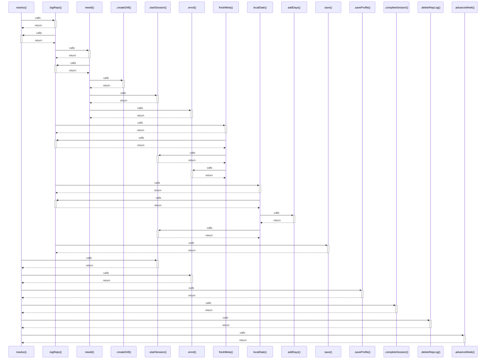

# nowIso()

> God node · 8 connections · [C:\Users\matth\Code\skill-dev-app\src\lib\util\time.ts](file:///C:/Users/matth/Code/skill-dev-app/src/lib/util/time.ts#L33)

## Call Trace Diagram

## Connections by Relation

### calls

- [[.logReps()]] `INFERRED`
- [[.startSession()]] `INFERRED`
- [[.enrol()]] `INFERRED`
- [[.saveProfile()]] `INFERRED`
- [[.completeSession()]] `INFERRED`
- [[.deleteRepLog()]] `INFERRED`
- [[.advanceWeek()]] `INFERRED`

### contains

- [[time.ts]] `EXTRACTED`

---

_Part of the graphify knowledge wiki. See [[index]] to navigate._
