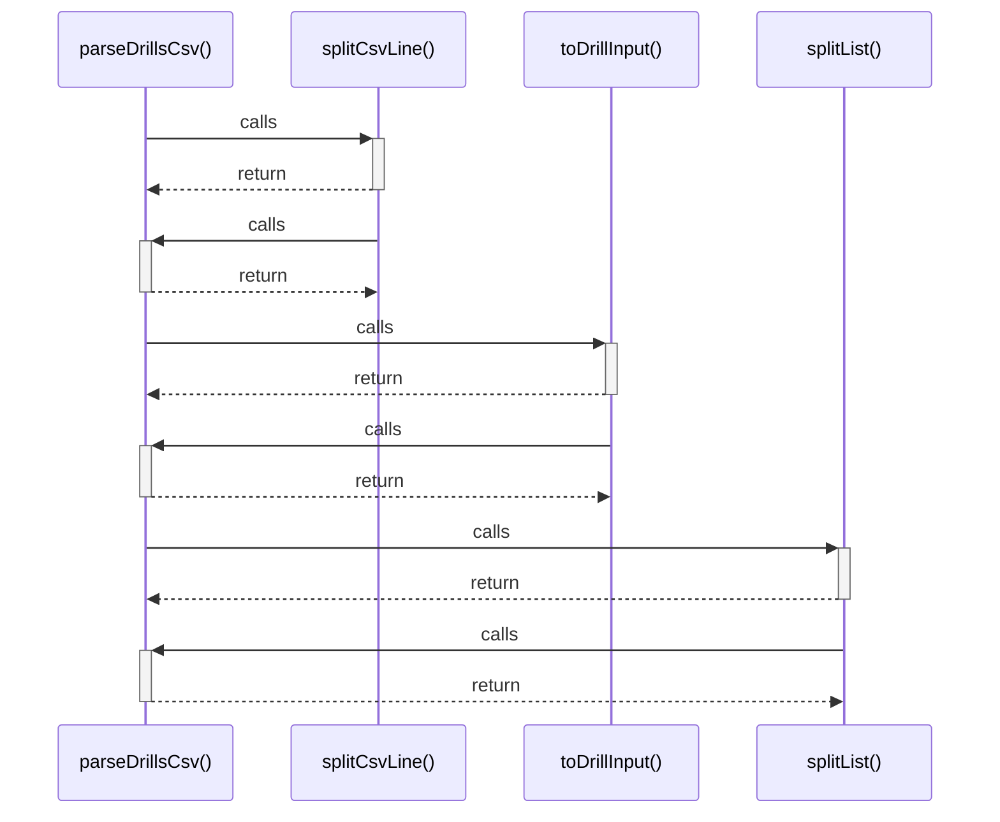

# parseDrillsCsv()

> God node · 4 connections · [C:\Users\matth\Code\skill-dev-app\src\lib\domain\drill-import.ts](file:///C:/Users/matth/Code/skill-dev-app/src/lib/domain/drill-import.ts#L68)

## Call Trace Diagram

## Connections by Relation

### calls

- [[splitCsvLine()]] `EXTRACTED`
- [[toDrillInput()]] `EXTRACTED`
- [[splitList()]] `EXTRACTED`

### contains

- [[drill-import.ts]] `EXTRACTED`

---

_Part of the graphify knowledge wiki. See [[index]] to navigate._
