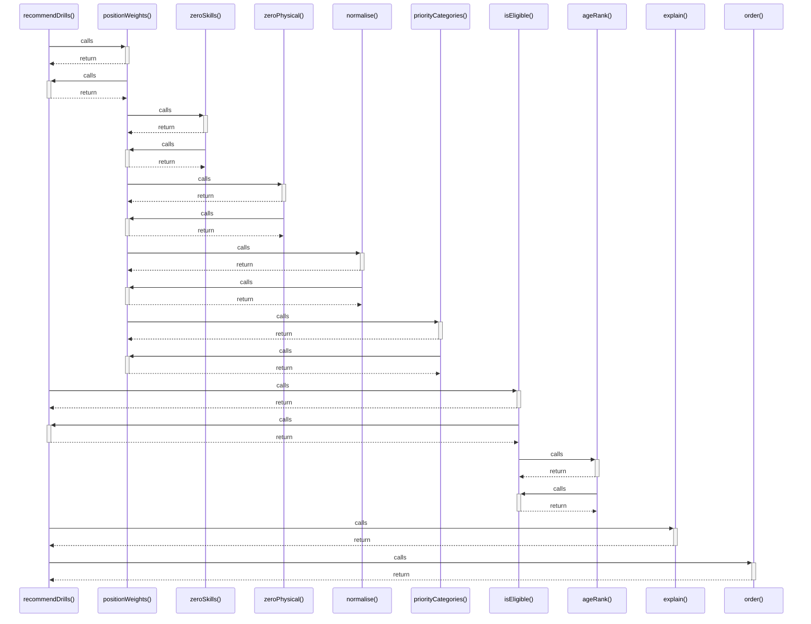

# recommendDrills()

> God node · 5 connections · [C:\Users\matth\Code\skill-dev-app\src\lib\domain\recommend.ts](file:///C:/Users/matth/Code/skill-dev-app/src/lib/domain/recommend.ts#L262)

## Call Trace Diagram

## Connections by Relation

### calls

- [[positionWeights()]] `EXTRACTED`
- [[isEligible()]] `EXTRACTED`
- [[explain()]] `EXTRACTED`
- [[order()]] `INFERRED`

### contains

- [[recommend.ts]] `EXTRACTED`

---

_Part of the graphify knowledge wiki. See [[index]] to navigate._
