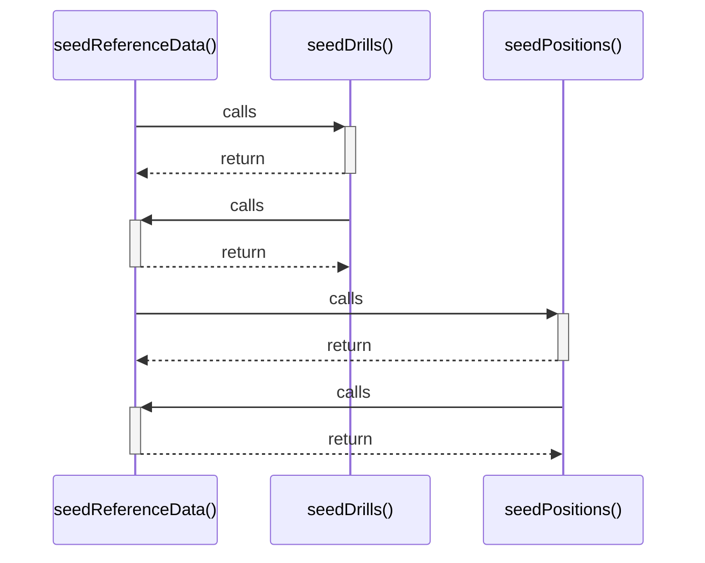

# seedReferenceData()

> God node · 3 connections · [C:\Users\matth\Code\skill-dev-app\src\lib\data\index.ts](file:///C:/Users/matth/Code/skill-dev-app/src/lib/data/index.ts#L52)

## Call Trace Diagram

## Connections by Relation

### calls

- [[seedDrills()]] `EXTRACTED`
- [[seedPositions()]] `EXTRACTED`

### contains

- [[index.ts]] `EXTRACTED`

---

_Part of the graphify knowledge wiki. See [[index]] to navigate._
